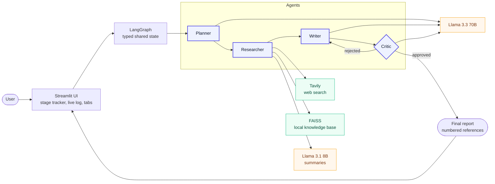
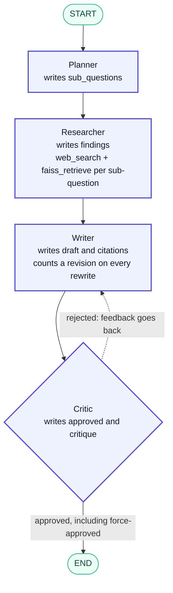
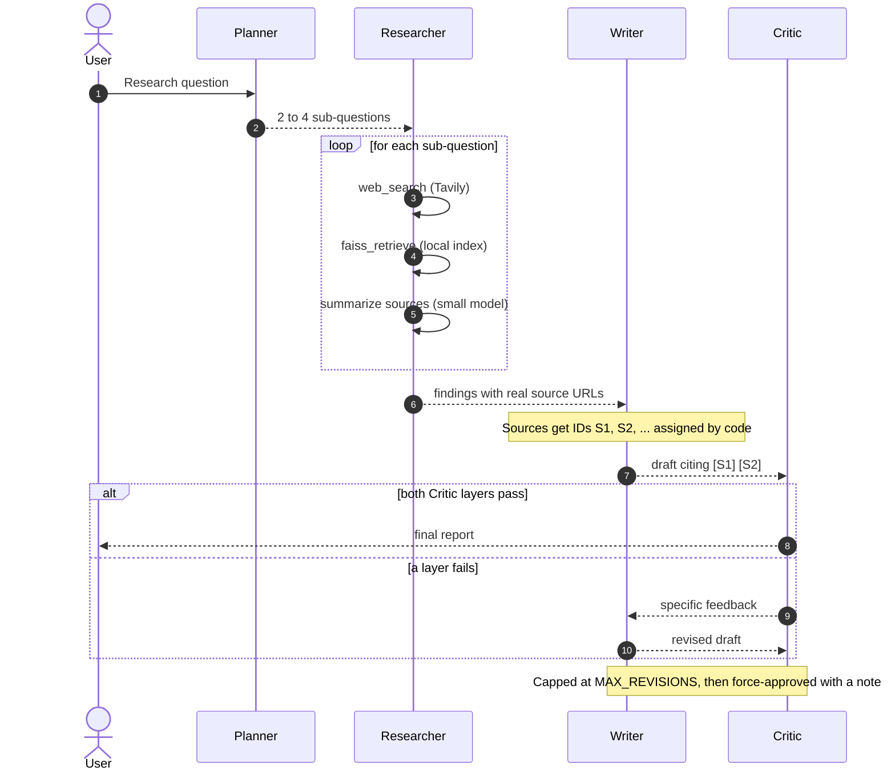
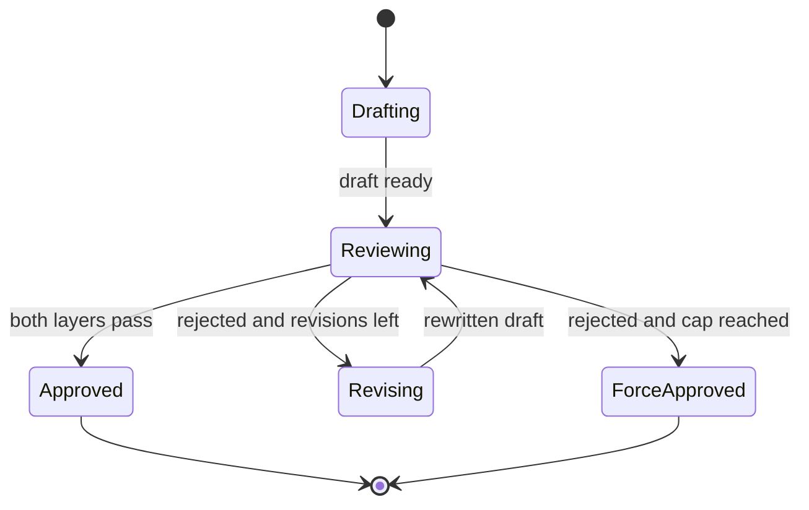
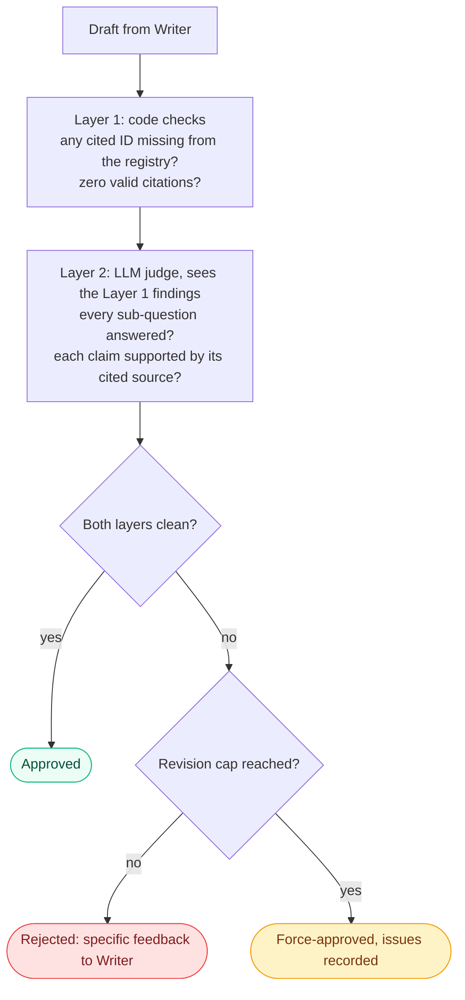
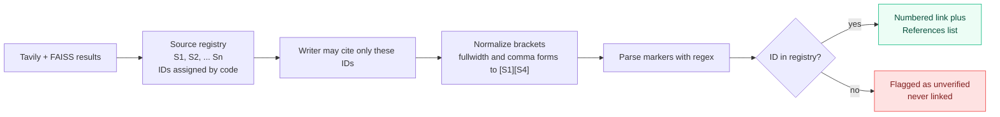
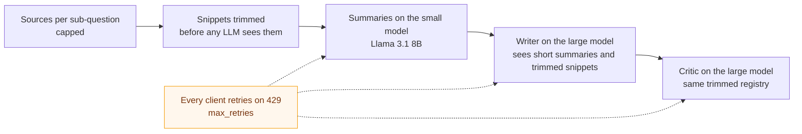
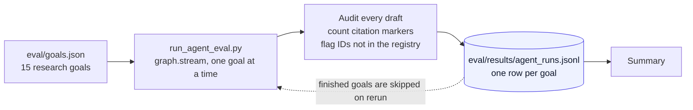
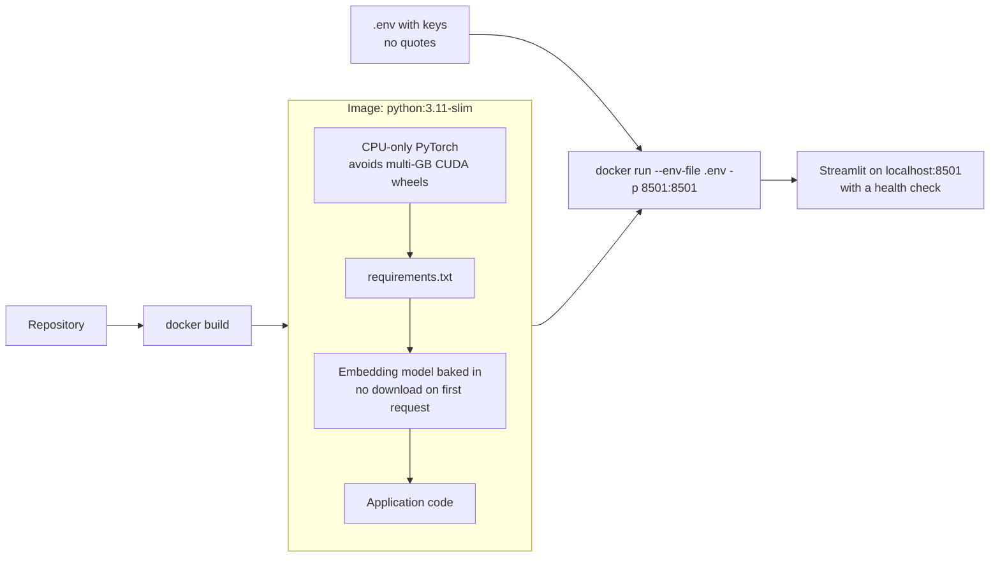

<div align="center">

```
 ┌──────────────────────────────────────────────────────────────┐
 │   PLAN   ──▶   RESEARCH   ──▶   WRITE   ──▶   CRITIQUE       │
 │                                    ▲              │          │
 │                                    └── revise ────┘          │
 └──────────────────────────────────────────────────────────────┘
```

# Multi-Agent Research Assistant

**Four agents plan a question, research it, write a cited report, and fact-check each other before you see an answer.**
Every citation is verified in code. Every step is visible.


[Why](#why-this-exists) &nbsp;|&nbsp; [How it works](#how-it-works) &nbsp;|&nbsp; [Evaluation](#evaluation) &nbsp;|&nbsp; [Quick start](#quick-start) &nbsp;|&nbsp; [Docker](#run-with-docker) &nbsp;|&nbsp; [Design decisions](#design-decisions)

<!-- Add a screenshot of the Trace tab (a run where the Critic rejected a draft), then uncomment:

-->

</div>

---

## Why this exists

Most "AI research assistant" demos are one LLM call with a search tool attached. You get a confident report and no way to tell which claims are real, which sources were used, or whether the model made something up.

This project treats that as an engineering problem:

| Problem | What this project does |
|---|---|
| The model invents citations | Source IDs are assigned by **code**. Every citation in a draft is parsed and checked against what was actually retrieved. |
| Nothing checks the first draft | A separate **Critic agent** reviews each draft and can send it back for revision. |
| You only see the answer | A live **trace** shows sub-questions, tool calls, every draft, and every piece of feedback. |
| Loops can run forever | A **revision cap** force-approves with the unresolved issues recorded. |
| "It works" is a claim, not a measurement | An **evaluation harness** audits citation integrity across a set of research goals. |

---

## How it works

### System overview



### The agent graph

Each node reads the shared state and returns an update. The dotted edge is the only conditional branch in the graph.



### One run, step by step



### The revision loop as a state machine



### How the Critic decides

Two layers, because an LLM judge alone can be talked into approving a bad draft. The code layer cannot be argued with.



### How citations stay honest



### Staying inside a free-tier token budget

One run makes several large LLM calls, so the pipeline is built to spend tokens carefully.



### Shared state

Every node reads and writes one typed object. That is what makes each step inspectable in the trace.

| Field | Written by | Purpose |
|---|---|---|
| `question` | input | The original research question |
| `sub_questions` | Planner | 2 to 4 independently searchable questions |
| `findings` | Researcher | Per sub-question: sources (with the tool that found each) and a short summary |
| `draft` | Writer | Current report text, overwritten on each revision |
| `citations` | Writer | Claim-to-source mappings built by parsing the draft in code |
| `critique` | Critic | Specific feedback, or `None` on a clean approval |
| `revision_count` | Writer | Compared against `MAX_REVISIONS` to stop infinite loops |
| `approved` | Critic | The flag the conditional edge branches on |

---

## The interface

The trace is the point. A viewer can watch the agents work and see exactly where a draft was rejected and why.

| Element | What it shows |
|---|---|
| Stage tracker | Four pills with a pulsing dot on the active agent |
| Live card log | Color-coded cards: green approved, red rejected, amber force-approved |
| Final report tab | Numbered, clickable citations and a References list; download as Markdown |
| Trace tab | Sub-questions, every tool call, every draft with its verdict, every critic comment |
| Sources tab | A table mapping each internal source ID to its title, URL, and sub-question |

<!-- Add screenshots to assets/ and uncomment:


-->

---

## Evaluation

Quality claims here are meant to be measured. `eval/run_agent_eval.py` runs the full graph over a set of research goals and audits every draft the Writer produces, using the same parser the Critic uses.



| Metric | Meaning |
|---|---|
| Citation markers checked | Every `[S#]` marker across all drafts |
| Fabricated IDs caught | Markers pointing at a source that was never retrieved |
| Fabricated IDs in final reports | The ones that survived to the answer a user sees |
| First drafts rejected | How often the Critic sent a first draft back |
| Rejected, then fixed | Of those, how many the revision loop repaired without a force-approve |
| Force-approved runs | Runs that hit the revision cap |

```bash
python -m eval.run_agent_eval --limit 8     # run up to 8 new goals (cached, resumable)
python -m eval.run_agent_eval --summary-only
```

Results are cached per goal, so a rate-limit stop is harmless: run it again and it continues. Use `--limit` to stay inside a free-tier daily budget.

<!-- After running the evaluation, paste your real numbers here:
| Runs | Markers checked | Fabricated caught | Fabricated in final | First drafts rejected | Fixed |
|---|---|---|---|---|---|
| N | N | N | N | N | N |
-->

---

## Tech stack

| Layer | Choice | Why |
|---|---|---|
| Orchestration | LangGraph | Explicit nodes and a conditional loop, not a linear chain |
| LLMs | Groq: Llama 3.3 70B and Llama 3.1 8B | Fast inference; the small model handles high-volume summarizing |
| Structured output | Pydantic via `with_structured_output` | Planner and Critic return validated objects, not text to parse |
| Web search | Tavily | Clean, attributed snippets with URLs |
| Local retrieval | FAISS + `all-MiniLM-L6-v2` | Free local embeddings over your own `.txt` files |
| UI | Streamlit | Streams graph updates live |
| Packaging | Docker | One command to run anywhere |

---

## Project structure

```
multi-agent-research-assistant/
├── app.py                      # Streamlit UI: tracker, live log, tabs
├── config.py                   # Single source of truth for env vars and model names
├── Dockerfile
├── requirements.txt
├── .env.example
├── .streamlit/
│   └── config.toml             # Theme and server settings
├── graph/
│   ├── state.py                # ResearchState schema (imports nothing from the project)
│   ├── build_graph.py          # Nodes, edges, and the Critic conditional edge
│   └── nodes/
│       ├── planner.py
│       ├── researcher.py
│       ├── writer.py           # Source registry, citation normalizing and parsing
│       └── critic.py
├── tools/
│   ├── web_search.py           # Tavily wrapper
│   └── faiss_retriever.py      # Build or load the local index
├── eval/
│   ├── goals.json              # Research goals for the evaluation
│   └── run_agent_eval.py       # Citation-integrity evaluation
├── data/
│   └── knowledge_base/         # Put .txt files here for local retrieval
└── assets/                     # Screenshots for this README
```

---

## Quick start

**1. Clone and install**

```bash
git clone https://github.com/ADHIRAJ994/multi-agent-research-assistant.git
cd multi-agent-research-assistant
python -m venv .venv
.venv\Scripts\activate          # macOS/Linux: source .venv/bin/activate
pip install -r requirements.txt
```

**2. Add your keys**

```bash
cp .env.example .env            # Windows: copy .env.example .env
```

Fill in `GROQ_API_KEY` ([console.groq.com](https://console.groq.com)) and `TAVILY_API_KEY` ([tavily.com](https://tavily.com)). Both have free tiers.

**3. Add a knowledge base**

Put at least one `.txt` file in `data/knowledge_base/`. The FAISS index is built from these on first run and reused afterward.

**4. Run**

```bash
streamlit run app.py
```

Or run the graph from the terminal with no UI:

```bash
python -m graph.build_graph
```

### Configuration

| Variable | Default | Purpose |
|---|---|---|
| `GROQ_API_KEY` | required | Groq access |
| `TAVILY_API_KEY` | required | Web search |
| `FAISS_INDEX_PATH` | `./data/index` | Where the vector index is saved |
| `MAX_REVISIONS` | `2` | Writer to Critic loop cap |
| `MAIN_MODEL` | `llama-3.3-70b-versatile` | Planner, Writer, Critic |
| `FAST_MODEL` | `llama-3.1-8b-instant` | Researcher summaries |

---

## Run with Docker



```bash
docker build -t research-agent .
docker run --env-file .env -p 8501:8501 research-agent
```

Open `http://localhost:8501`.

---

## Design decisions

**Citation IDs come from code, never from the model.** The Researcher's output becomes a registry (`S1`, `S2`, ...) and the Writer may cite only those IDs. After drafting, a parser extracts every marker and checks it against the registry. A made-up ID is flagged as unverified and never rendered as a link.

**Two-layer Critic.** The deterministic layer catches fabricated IDs and missing citations no matter what the LLM says. The LLM layer judges coverage and whether a source supports its claim. A draft passes only if both are clean.

**Citation brackets are normalized before parsing.** Models sometimes emit `【S16】` or `[S1, S4]` instead of `[S1][S4]`. Without normalizing, a formatting quirk looks like "no citations" and triggers a false rejection that wastes a revision.

**Force-approve instead of looping forever.** After `MAX_REVISIONS` failed attempts the graph exits and keeps the unresolved issues in the output. The UI labels this outcome separately from a clean approval.

**Typed shared state.** One `TypedDict` carries everything. Nodes return `{**state, ...}` updates rather than mutating globals, so every step is inspectable.

**Per-stage model choice.** Summarizing is high-volume and simple, so it runs on the small model. Judgment-heavy stages run on the large one.

**Import-safe modules.** Anything that makes a network call or builds an index lives under `if __name__ == "__main__"`, so importing a module never fires a live request.

---

<details>
<summary><strong>Troubleshooting</strong></summary>

**`429` rate-limit errors from Groq.** The free tier has tight per-minute and per-day token limits, and one run makes several large calls. The error text names which limit you hit: a per-minute limit clears in under a minute, a per-day limit does not. Lower `MAX_REVISIONS`, use fewer sub-questions, or move to a paid tier.

**`ModuleNotFoundError: No module named 'graph'` (or `config`, `tools`).** Run from the project root and use module form: `python -m graph.build_graph`, `python -m eval.run_agent_eval`.

**`InvalidAPIKeyError` from Tavily inside Docker.** `docker run --env-file` does not strip quotes. Write `TAVILY_API_KEY=tvly-xxxx` with no quotes and no spaces around `=`.

**FAISS fails on first run.** `data/knowledge_base/` needs at least one `.txt` file before the index can be built.

**Circular import errors.** `graph/state.py` must import nothing from the project. Graph wiring belongs in `build_graph.py`.

</details>

---

## Known limitations

- **Free-tier rate limits.** A heavy day can hit the daily cap, and a deployed demo shares one budget across all visitors.
- **Sequential research.** The Researcher handles sub-questions one at a time. LangGraph's `Send` could parallelize this.
- **The LLM judge is imperfect.** In testing, it approved a draft with an uncited claim that the code layer did not catch. A deterministic check that every factual sentence carries a marker would close the gap.
- **Writer and Critic share a model family**, which can share blind spots.

## Roadmap

- [ ] Parallel sub-question research with `Send`
- [ ] Deterministic uncited-claim detector in the Critic
- [ ] Configurable search provider
- [ ] Upload documents from the UI into the FAISS index
- [ ] Deploy a public demo

---

## Author

**Adhiraj Chakravorty**
B.Tech CSE (AI and ML), VIT-AP University
[GitHub](https://github.com/ADHIRAJ994) &nbsp;|&nbsp; [LinkedIn](https://linkedin.com/in/adhiraj-chakravorty-788685344)

<div align="center">
<sub>Built with LangGraph, Groq, FAISS, Streamlit, and Docker.</sub>
</div>