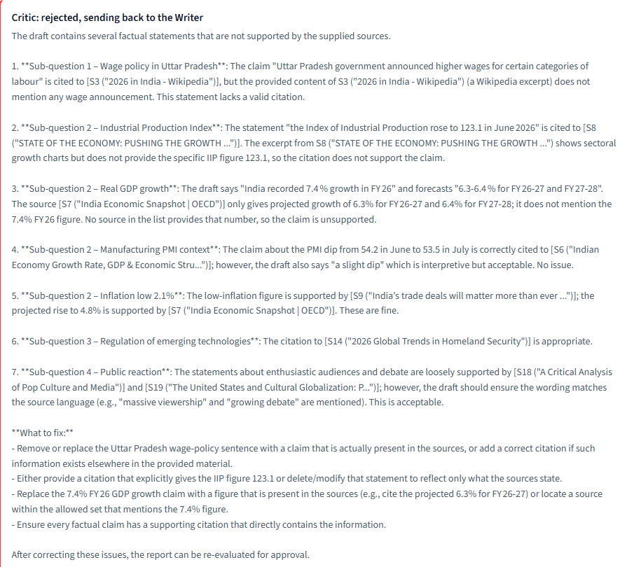
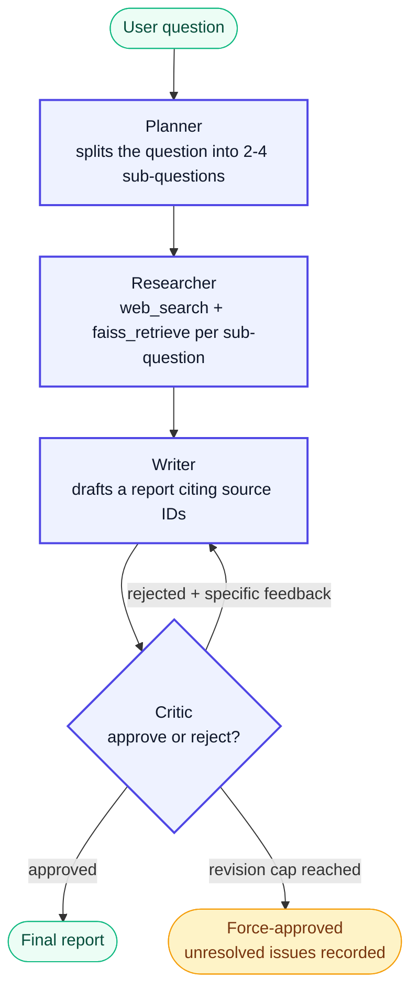
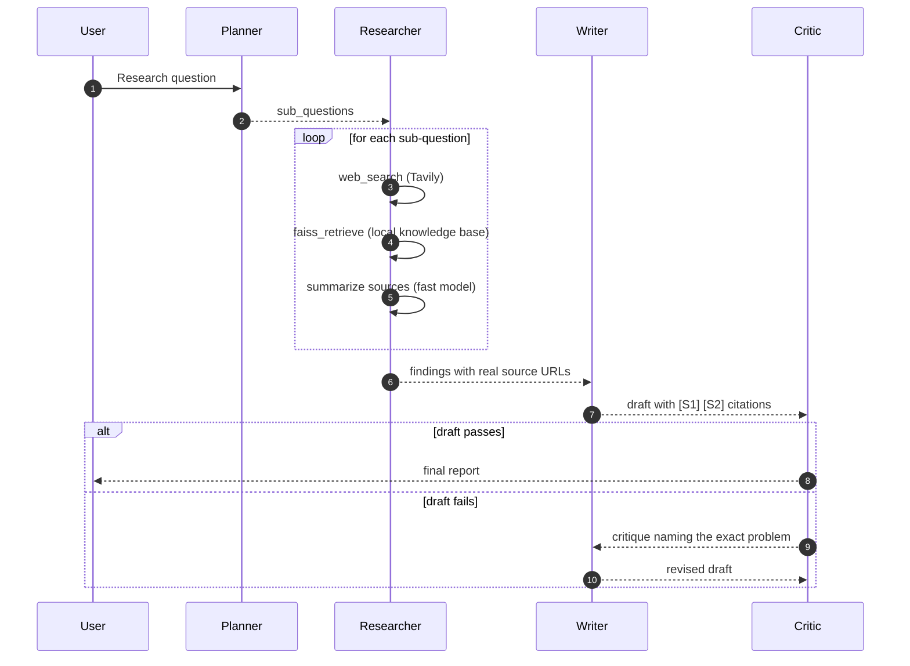
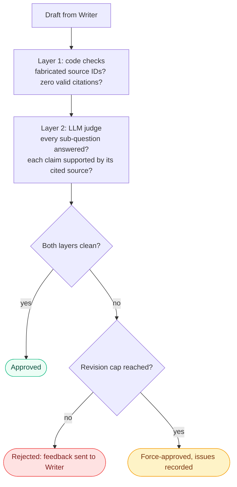
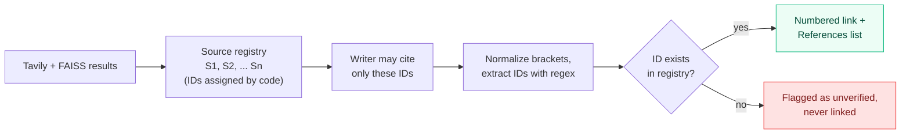

<div align="center">

# Multi-Agent Research Assistant

**Ask a question. Four agents plan it, research it, write it, and fact-check each other before you see an answer.**


[Live Demo](#) &nbsp;|&nbsp; [Architecture](#architecture) &nbsp;|&nbsp; [Quick Start](#quick-start) &nbsp;|&nbsp; [Design Decisions](#design-decisions)

<!-- Replace with a screenshot or GIF of the trace panel -->


</div>

---

## The problem

Most "AI research assistant" demos are one LLM call with a search tool attached. You get a confident-sounding report and no way to tell which claims are real, which sources were used, or whether the model made something up.

This project treats that as an engineering problem, not a prompting problem:

- Every citation points to a source that was **actually retrieved**. IDs are assigned by code, so the model cannot invent one.
- A separate **Critic agent** reviews each draft and can send it back for revision.
- The whole process is **visible**: sub-questions, tool calls, every draft, every piece of critic feedback.

---

## At a glance

| | |
|---|---|
| **Agents** | Planner, Researcher, Writer, Critic |
| **Orchestration** | LangGraph state graph with a conditional Writer to Critic loop |
| **Retrieval** | Tavily web search plus a local FAISS index (sentence-transformers embeddings) |
| **LLMs** | Llama 3.3 70B for reasoning and writing, Llama 3.1 8B for summarizing, both on Groq |
| **State** | One typed `ResearchState` shared by every node |
| **Guardrails** | Code-verified citations, revision cap, force-approve with an audit note |
| **UI** | Streamlit with a live stage tracker and a full trace tab |

---

## Architecture

### The agent graph



### One run, step by step



### How the Critic decides

The Critic runs two layers. Code checks cannot be argued with. The LLM judge covers what code cannot, such as whether a source really supports a claim.



### How citations stay honest



### Shared state

Every node reads from and writes to one typed object, which is what makes the graph debuggable.

| Field | Written by | Purpose |
|---|---|---|
| `question` | input | The original research question |
| `sub_questions` | Planner | 2 to 4 independently searchable questions |
| `findings` | Researcher | Per sub-question: sources (with the tool that found them) and a short summary |
| `draft` | Writer | Current report text, overwritten on each revision |
| `citations` | Writer | Claim-to-source mappings built by parsing the draft in code |
| `critique` | Critic | Specific feedback, or `None` when cleanly approved |
| `revision_count` | Writer | Checked against `MAX_REVISIONS` to stop infinite loops |
| `approved` | Critic | The flag the conditional edge branches on |

---

## What the UI shows

The trace is the point. A viewer can watch the agents work and see exactly where a draft was rejected and why.

| Stage tracker | Live card log | Trace tab |
|---|---|---|
| Four pills with a pulsing dot on the active agent | Colored cards: green for approved, red for rejected, amber for force-approved | Every draft with its verdict, every tool call, every retrieved source |

<!-- Add screenshots here -->
<!--  -->
<!--  -->

Final reports use numbered, clickable citations with a References list. Internal source IDs (`S16`) are shown with their titles in the Critic's feedback so a reader can always map one to the other.

---

## Tech stack

| Layer | Choice | Why |
|---|---|---|
| Orchestration | LangGraph | Explicit nodes, edges, and a conditional loop, not a linear chain |
| LLM | Groq (Llama 3.3 70B, Llama 3.1 8B) | Fast inference; the small model handles summarizing to save the larger model's budget |
| Structured output | Pydantic via `with_structured_output` | The Planner and Critic return validated objects, not text to parse |
| Web search | Tavily | Returns clean, attributed snippets with URLs |
| Local retrieval | FAISS + `all-MiniLM-L6-v2` | Free, local embeddings; searches your own `.txt` knowledge base |
| UI | Streamlit | Live streaming of graph updates |
| Config | `python-dotenv` | Keys stay out of the code |

---

## Project structure

```
multi-agent-research-assistant/
├── app.py                      # Streamlit UI: stage tracker, live log, trace tab
├── config.py                   # Single source of truth for env vars and model names
├── requirements.txt
├── .env.example
├── .streamlit/
│   └── config.toml             # Theme and server settings
├── graph/
│   ├── state.py                # ResearchState schema (imports nothing from the project)
│   ├── build_graph.py          # Nodes, edges, and the Critic conditional edge
│   └── nodes/
│       ├── planner.py
│       ├── researcher.py
│       ├── writer.py
│       └── critic.py
├── tools/
│   ├── web_search.py           # Tavily wrapper
│   └── faiss_retriever.py      # Build or load the local index
└── data/
    └── knowledge_base/         # Drop .txt files here for local retrieval
```

---

## Quick start

**1. Clone and install**

```bash
git clone https://github.com/ADHIRAJ994/multi-agent-research-assistant.git
cd multi-agent-research-assistant
python -m venv .venv
.venv\Scripts\activate          # macOS/Linux: source .venv/bin/activate
pip install -r requirements.txt
```

**2. Add your keys**

```bash
cp .env.example .env            # Windows: copy .env.example .env
```

Fill in `GROQ_API_KEY` ([console.groq.com](https://console.groq.com)) and `TAVILY_API_KEY` ([tavily.com](https://tavily.com)). Both have free tiers.

**3. Add a knowledge base**

Put at least one `.txt` file in `data/knowledge_base/`. The FAISS index is built from these on first run and reused afterward.

**4. Run**

```bash
streamlit run app.py
```

Run the graph from the terminal instead, with no UI:

```bash
python -m graph.build_graph
```

### Configuration

| Variable | Default | Purpose |
|---|---|---|
| `GROQ_API_KEY` | required | Groq access |
| `TAVILY_API_KEY` | required | Web search |
| `FAISS_INDEX_PATH` | `./data/index` | Where the vector index is saved |
| `MAX_REVISIONS` | `2` | Writer to Critic loop cap |

---

## Design decisions

**Citation IDs are assigned by code, never by the model.** The Researcher's output is turned into a registry (`S1`, `S2`, ...) and the Writer is told to cite only those IDs. After drafting, a parser extracts every marker and checks it against the registry. A made-up ID is flagged as unverified and never rendered as a link.

**Two-layer Critic.** An LLM judge alone can be talked into approving a bad draft. The deterministic layer catches fabricated IDs and missing citations regardless of what the LLM says. The LLM layer handles coverage and whether a source supports its claim. A draft passes only if both layers are clean.

**Normalizing citation brackets.** Models occasionally emit `【S16】` or `[S1, S4]` instead of `[S1][S4]`. A normalization step rewrites these before parsing, so a formatting quirk cannot cause a false "no citations" rejection.

**Force-approve instead of looping forever.** After `MAX_REVISIONS` failed attempts the graph exits, and the unresolved issues are kept in the output. The UI labels this outcome separately from a clean approval.

**Typed shared state.** One `TypedDict` carries everything. Nodes return `{**state, ...}` updates rather than mutating globals, which is what makes every step inspectable in the trace.

**Per-stage model choice.** Summarizing is high-volume and simple, so it runs on the small model. Judgment-heavy stages (Planner, Writer, Critic) run on the larger one.

---

## Known limitations

- **Free-tier rate limits.** Groq's free tier has tight per-minute and per-day token limits. One run makes several large calls, and the live demo shares one budget across all visitors. The code trims snippets, caps sub-questions, uses the small model for summaries, and retries on 429s, but a heavy day can still hit the cap.
- **Sequential research.** The Researcher loops over sub-questions one at a time. LangGraph's `Send` could fan these out in parallel.
- **LLM judge is imperfect.** In testing, the LLM layer approved a draft containing an uncited claim that the code layer did not catch. A deterministic "every factual sentence needs a marker" check would close this gap.
- **Same model family for writer and critic.** A stronger or different model as Critic would reduce shared blind spots.

---

## Roadmap

- [ ] Parallel sub-question research with `Send`
- [ ] Benchmark of 20 research goals with task-completion and groundedness scores
- [ ] Deterministic uncited-claim detector in the Critic
- [ ] Swap Tavily for a configurable search provider
- [ ] Upload your own documents from the UI into the FAISS index

---

## Author

**Adhiraj Chakravorty**  
B.Tech CSE (AI & ML), VIT-AP University  
[GitHub](https://github.com/ADHIRAJ994) &nbsp;|&nbsp; [LinkedIn](https://linkedin.com/in/adhiraj-chakravorty-788685344)

---

<div align="center">
<sub>Built with LangGraph, Groq, FAISS, and Streamlit.</sub>
</div>